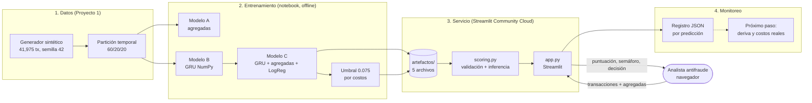

# Proyecto Final — Modelo de fraude transaccional en producción

Deep Learning y Sistemas Inteligentes, Universidad del Valle de Guatemala, 2026.

**Integrantes:** José Ordoñez (231329) · José Alejandro Antón (221041) · Adrián González (23152)

**Repositorio:** https://github.com/JoseOrdonezB/PROYECTO-FINAL

**App en producción:** URL_DE_LA_APP (Streamlit Community Cloud)

Este repo pone en producción el **modelo C** del Proyecto 1 (monitoreo transaccional del
Banco del Altiplano): un híbrido que junta el estado oculto de una GRU con las variables
agregadas del cliente y saca una probabilidad de fraude con una regresión logística.
Cualquier persona puede abrir la URL, cargar las últimas transacciones de un cliente y ver
si el modelo autorizaría o bloquearía la última.

---

## 1. Problemática

**Problema.** El banco detecta fraude con reglas y variables agregadas (cuánto gasta,
cuántas veces, en cuántos comercios). El fraude que se les escapa casi siempre se ve en el
*orden* de las operaciones: varias compras chiquitas de prueba y luego una grande, o un
cambio de canal repentino. En el Proyecto 1 mostramos que un modelo secuencial sí captura
eso; lo que faltaba era que alguien fuera del equipo lo pudiera usar.

**Usuario.** El analista del equipo de operaciones antifraude, que decide en el momento si
una transacción pasa o no. No necesita saber nada de redes neuronales: ve una puntuación,
un semáforo y una decisión.

**Decisión que depende del modelo.** Autorizar o bloquear la transacción (y mandarla a
revisión manual). Si la puntuación es ≥ 0.075 se bloquea; si no, se autoriza. El semáforo
ayuda a priorizar: verde (< 0.0375), ámbar (entre 0.0375 y 0.075, se autoriza pero conviene
vigilar) y rojo (≥ 0.075, se bloquea).

## 2. Planificación

Nos repartimos el trabajo en tres bloques que se podían hacer casi en paralelo, con el
contrato de entrada/salida de `scoring.py` como punto de unión.

| Etapa | Qué se hizo | Responsable | Fechas |
|---|---|---|---|
| 0. Elección del modelo | Elegir proyecto base (P1, modelo C) y alcance: solo inferencia, Streamlit, hosting gratis | Los tres | 11/11 |
| 1. Scoring | Subir el proyecto base, extraer la inferencia a `scoring.py` y validarla contra `resultados.json` | José Ordoñez (A) | 12/11 |
| 2. App | Pantallas en Streamlit, conexión con `scoring.py`, manejo de errores, `requirements.txt`, script de despliegue | José Alejandro Antón (B) | 13/11 |
| 3. Despliegue | Intento en Hugging Face (ahora pide plan PRO) y despliegue final en Streamlit Community Cloud; probar la URL desde otro equipo | José Alejandro Antón (B) | 13–14/11 |
| 4. Evidencias | Capturas, prueba documentada entrada → salida, registro de uso | Adrián González (C) | 13–14/11 |
| 5. Documentación | Este README y `presentacion.pdf` | Adrián González (C) | 13/11 |
| 6. Revisión cruzada | Cada quien explica el código de los otros, se prueba la URL, checklist final | Los tres | 14/11 |
| Presentación | 10 min + 5 de preguntas | Los tres | 13/11 |
| Entrega final | Última versión del repo | Los tres | 15/11, 23:59 |

## 3. Supuestos

**Sobre los datos**
- Los datos son **sintéticos** (41,975 transacciones de 3,000 clientes, 0.715 % de fraude,
  cinco mecanismos de fraude). El desempeño real seguramente sería menor.
- Las transacciones que llegan en producción tienen la misma forma que en el entrenamiento:
  monto en quetzales, hora 0–23, canal en {POS, online, ATM} y categoría en {comida, retail,
  viajes, entretenimiento, servicios}. Lo que no cumpla esto se rechaza con un mensaje.
- Las 13 variables agregadas las calcula el sistema del banco con la misma lógica causal
  del notebook (solo con información pasada). En la app el usuario las ingresa a mano y la
  app deriva tres de ellas (hora, log del monto y log de horas desde la anterior) de la
  última fila.
- Si el cliente tiene menos de 10 transacciones, la secuencia se rellena con ceros a la
  izquierda, igual que en el entrenamiento.

**Sobre el usuario**
- Es un analista que ve una transacción a la vez, no un proceso masivo. Por eso una app web
  le sirve más que una API.
- Entiende la regla "arriba del umbral se bloquea" y sabe que un bloqueo va a revisión
  manual, no es un rechazo definitivo.

**Sobre el entorno**
- Streamlit Community Cloud gratis (~1 GB de RAM) alcanza: una predicción tarda ~0.4 ms
  (mediana medida localmente, p95 ~0.6 ms), así que el cuello de botella es la interfaz.
- La app se "duerme" después de 12 horas sin visitas; la primera carga después de eso tarda
  un poco (hay que darle al botón de despertarla).
- Los costos del umbral (Q4,200 por fraude que se escapa, Q180 por bloquear a un cliente
  legítimo) son los hipotéticos del enunciado del Proyecto 1, no cifras reales del banco.

## 4. Modelo planteado

**Proyecto de origen.** Proyecto 1 — "Monitoreo transaccional: detectar lo que el orden
revela" (José Ordoñez y Adrián González). El notebook, informe, figuras y artefactos
originales están en [`proyecto-base/`](proyecto-base/).

**Arquitectura (modelo C, híbrido).**

```
últimas 10 transacciones ──► vector de 14 variables por paso ──► GRU (NumPy, 24 neuronas)
                                                                      │ estado oculto final (24)
                                                                      ▼
13 variables agregadas ──► StandardScaler (ajustado en train) ──► concatenar (37) ──► Regresión logística ──► P(fraude)
                                                                                                         │
                                                                                         ≥ 0.075 → bloquear, si no → autorizar
```

- Vector por paso (14): `log1p(monto)`, seno y coseno de la hora, `log1p(horas desde la
  anterior)`, comercio nuevo, one-hot de canal (3) y de categoría (5).
- La GRU se implementó a mano en NumPy en el Proyecto 1 (con chequeo de gradiente). Aquí
  solo se usa su *forward*.
- Agregadas (13): `n_tx_1h, n_tx_24h, div_comercio_7d, div_canal_7d, ratio_monto_hist,
  n_tx_historicas, hora, es_fin_semana, es_comercio_nuevo, log_monto, log_monto_prom_24h,
  log_monto_max_dia, log_horas_desde_ultima`.

**Artefactos** (en [`artefactos/`](artefactos/), los 5 que necesita la inferencia):

| Archivo | Para qué |
|---|---|
| `modelo_B_gru_pesos.npz` | Pesos de la GRU (se usa el estado oculto) |
| `modelo_C_logreg.pkl` | Regresión logística final |
| `scaler_agg.pkl` | Escalado de las 13 agregadas |
| `columnas_agregadas.json` | Orden exacto de las agregadas |
| `parametros_preparacion.json` | Umbral (0.075), ventana W = 10, costos |

**Cambios para producción y por qué**

1. **No se reentrenó nada.** El modelo C ya estaba validado en el Proyecto 1; reentrenar
   habría cambiado los números sin necesidad. Solo se extrajo la inferencia.
2. **GRU solo forward en NumPy.** No hace falta PyTorch ni TensorFlow, así que la imagen
   del servicio es liviana y arranca rápido.
3. **`scoring.py` con un contrato explícito** de entrada/salida y errores propios
   (`EntradaInvalidaError`, `ArtefactosNoEncontradosError`) para que la app muestre
   mensajes claros en vez de fallar.
4. **Versiones fijadas** (`numpy 1.26.4`, `scikit-learn 1.3.2`, `pandas 2.1.4`) compatibles
   con el hosting. Los artefactos se guardaron con scikit-learn 1.8, así que verificamos que
   con estas versiones se cargan y dan exactamente los mismos resultados (sección 5).
5. **Semáforo** encima de la decisión binaria, para que el analista distinga los casos
   cercanos al umbral.
6. **Umbral configurable**: `score_transaccion(..., umbral=...)` acepta otro valor, y por
   defecto lee el de `parametros_preparacion.json`. Si el banco da costos reales, se cambia
   ahí sin tocar código.
7. **Registro de uso**: cada predicción o entrada inválida se escribe como una línea JSON
   (sin datos personales), base para monitorear deriva más adelante.

## 5. Validación de hipótesis

En el Proyecto 1 los criterios se definieron **antes de entrenar**, y todas las cifras salen
de [`proyecto-base/resultados/resultados.json`](proyecto-base/resultados/resultados.json).
La métrica principal es **AUC-PR**, porque el fraude es solo 0.7 % de los datos y la
exactitud no dice nada con esa desproporción.

| # | Hipótesis | Criterio de éxito | Línea base | Resultado | Veredicto |
|---|---|---|---|---|---|
| H1 | El orden de las transacciones aporta algo que las agregadas no capturan | AUC-PR val del secuencial (B) > el de agregadas (A) y cae al barajar la historia | A (HistGradientBoosting con agregadas): 0.8691 | B: 0.9019; al permutar la historia cae a 0.8193 (−9.2 %), sobre todo en cambio de canal (0.85 → 0.32) | Confirmada |
| H2 (apuesta C) | Juntar estado oculto + agregadas mejora a B | AUC-PR val (C) ≥ AUC-PR val (B) + 0.03 | B: 0.9019 | C: 0.9217 (+0.0198) | **No confirmada** (no llegó a +0.03), pero C quedó como el mejor modelo y fue el candidato final |
| H3 (producción) | `scoring.py` reproduce el modelo del notebook | Diferencia de AUC-PR en test < 0.01 y mismo umbral | Notebook: AUC-PR test 0.9590 | `scoring.py`: 0.9590, mismas precisión, recall, TP/FP/FN; diferencia máxima por puntuación 4.4e-6 | Confirmada |

Desempeño del modelo C en **test** (8,395 transacciones, 39 fraudes) con umbral 0.075:

| Métrica | Valor |
|---|---|
| AUC-PR | 0.9590 |
| Recall | 0.949 (37 de 39 fraudes) |
| Precisión | 0.474 (41 falsos positivos) |
| Costo con modelo vs. sin modelo | Q15,780 vs. Q163,800 |
| Ahorro en test (~10 días) | Q148,020 (≈ Q450,000 al mes, proyectado) |

El umbral es bajo a propósito: un fraude que se escapa cuesta ~23 veces más que bloquear a
un cliente legítimo, así que conviene bloquear de más. La validación de H3 se puede repetir
con `python validar_scoring.py` (salida guardada en
[`evidencias/validacion_scoring.txt`](evidencias/validacion_scoring.txt)).

**Limitaciones.** Datos sintéticos (resultados optimistas); `fraude_sigiloso` es el
mecanismo más difícil (puntuación media 0.74); el umbral depende de costos hipotéticos; y
todavía no hay monitoreo automático de deriva. Además encontramos un problema de
**arranque en frío**: si se manda una sola transacción (cliente sin historia), el modelo
da puntuaciones altas aunque la compra sea normal. Con el caso legítimo, una sola
transacción da 0.71 y con 2 a 10 transacciones da entre 0.002 y 0.027. En producción
convendría exigir al menos 2 transacciones o mandar los clientes nuevos a una regla aparte.

## 6. Herramientas y arquitectura

| Capa | Herramienta |
|---|---|
| Datos y entrenamiento | Jupyter + NumPy (GRU propia) + scikit-learn (Proyecto 1) |
| Artefactos | `.npz`, `.pkl`, `.json` versionados en el repo |
| Inferencia | `scoring.py` (NumPy + scikit-learn) |
| Interfaz | Streamlit (`app.py`) |
| Servicio | Streamlit Community Cloud (gratis, despliega desde GitHub) |
| Despliegue | Conexión directa al repo de GitHub (cada `git push` a `main` redespliega). `Dockerfile` como alternativa portable |
| Monitoreo | Registro JSON por predicción ("Manage app" → logs / `logs/uso.jsonl`) |
| Código | GitHub |



Flujo de una predicción: el usuario llena la tabla (o sube un CSV) → `app.py` valida
columnas, tipos y vacíos → arma las 13 agregadas → `scoring.evaluar_riesgo()` construye la
secuencia, corre la GRU, escala las agregadas y llama a la regresión logística → se muestra
puntuación, semáforo y decisión → se registra el evento.

### Estructura del repositorio

```
app.py                      interfaz Streamlit
scoring.py                  inferencia del modelo C (contrato documentado al inicio)
validar_scoring.py          reproduce las métricas de test con scoring.py
requirements.txt            dependencias fijadas
Dockerfile                  imagen Docker (alternativa para otro hosting)
artefactos/                 los 5 artefactos del modelo
despliegue/                 intento de despliegue en Hugging Face (ver nota abajo)
evidencias/                 capturas, prueba documentada, registros y validación
proyecto-base/              Proyecto 1 original (notebook, informe, figuras, resultados)
presentacion.pdf            presentación del proyecto final
```

## 7. Evidencias del pase a producción

**Enlace al servicio:** URL_DE_LA_APP

**Nota sobre el hosting.** El plan original era Hugging Face Spaces, pero al crear el Space
la API respondió `402 Payment Required`: desde 2026 los Spaces de Docker y Gradio en CPU
gratis piden suscripción PRO (Streamlit como SDK directo ya no existía desde 2025). Por eso
se desplegó en Streamlit Community Cloud, que es gratis para repos públicos y se conecta
directo a GitHub. El script `despliegue/subir_a_hf.py` y el `Dockerfile` quedan por si se
consigue una cuenta PRO o se usa otro hosting con Docker.

| Evidencia | Archivo |
|---|---|
| Pantalla inicial | [`evidencias/capturas_local/01_pantalla_inicial.png`](evidencias/capturas_local/01_pantalla_inicial.png) |
| Caso legítimo → 2.7 %, verde, AUTORIZAR | [`02_caso_legitimo.png`](evidencias/capturas_local/02_caso_legitimo.png) |
| Caso fraude (escalada rápida) → 100 %, rojo, BLOQUEAR | [`03_caso_fraude.png`](evidencias/capturas_local/03_caso_fraude.png) |
| Caso límite → 6.3 %, ámbar, AUTORIZAR | [`04_caso_limite_ambar.png`](evidencias/capturas_local/04_caso_limite_ambar.png) |
| Error de entrada (CSV sin columnas) → mensaje claro | [`05_error_entrada_csv.png`](evidencias/capturas_local/05_error_entrada_csv.png) |
| Capturas de la URL pública desde otro navegador | `evidencias/capturas_produccion/` |
| Prueba documentada entrada → salida (3 casos válidos y 3 inválidos) | [`evidencias/prueba_documentada.json`](evidencias/prueba_documentada.json) (genera: `prueba_documentada.py`) |
| Prueba automática de la interfaz (Streamlit AppTest) | [`evidencias/prueba_local_apptest.txt`](evidencias/prueba_local_apptest.txt) |
| Registro de uso (una línea JSON por evento) | [`evidencias/registro_uso_local.jsonl`](evidencias/registro_uso_local.jsonl) |
| Intento en Hugging Face (errores 400 y 402) | [`evidencias/intento_huggingface_402.txt`](evidencias/intento_huggingface_402.txt) |
| Validación de `scoring.py` contra el notebook | [`evidencias/validacion_scoring.txt`](evidencias/validacion_scoring.txt) |

Resumen de la prueba documentada:

| Caso | Entrada (última transacción) | Salida |
|---|---|---|
| Legítimo | POS, comida, Q88, 14 h, 75 h desde la anterior | 0.0267 → verde, autorizar |
| Fraude | 4 compras online pequeñas en minutos y luego Q1,400 online a las 3 h en comercio nuevo | 0.99999 → rojo, bloquear |
| Límite | POS, comida, Q95, 14 h | 0.0631 → ámbar, autorizar |
| Sin `monto` | — | `EntradaInvalidaError`: le faltan campos `['monto']` |
| Canal `WEB` | — | `EntradaInvalidaError`: canal no válido |
| Lista vacía | — | `EntradaInvalidaError`: lista no vacía requerida |

Ejemplo de registro de uso:

```json
{"ts": "2026-11-13T19:12:02+00:00", "evento": "prediccion", "origen": "Formulario", "n_tx": 10, "puntuacion": 0.999998, "decision": "bloquear", "semaforo": "rojo", "umbral": 0.075}
{"ts": "2026-11-13T19:12:17+00:00", "evento": "entrada_invalida", "origen": "Subir CSV", "detalle": "Faltan columnas en la entrada: ['categoria', 'es_nuevo', 'horas_desde_ultima']. ..."}
```

---

## Ejecución local

Requiere Python 3.10 o 3.11.

```bash
git clone https://github.com/JoseOrdonezB/PROYECTO-FINAL.git
cd PROYECTO-FINAL
python -m venv venv
source venv/bin/activate          # Windows: venv\Scripts\activate
pip install -r requirements.txt
streamlit run app.py              # abre http://localhost:8501
```

Otras pruebas:

```bash
python evidencias/prueba_documentada.py      # entrada -> salida, genera el JSON
pip install nbformat matplotlib
python validar_scoring.py                    # reproduce AUC-PR 0.9590 (~1 min)
cd evidencias && python prueba_local_apptest.py   # prueba la interfaz sin navegador
```

Uso directo del modelo desde Python:

```python
from scoring import evaluar_riesgo
txs = [{"monto": 105, "hora": 16, "canal": "POS", "categoria": "retail",
        "es_nuevo": 0, "horas_desde_ultima": 62},
       {"monto": 88, "hora": 14, "canal": "POS", "categoria": "comida",
        "es_nuevo": 0, "horas_desde_ultima": 75}]
agg = {"n_tx_1h": 1, "n_tx_24h": 1, "div_comercio_7d": 2, "div_canal_7d": 1,
       "ratio_monto_hist": 0.98, "n_tx_historicas": 24, "hora": 14, "es_fin_semana": 0,
       "es_comercio_nuevo": 0, "log_monto": 4.49, "log_monto_prom_24h": 4.49,
       "log_monto_max_dia": 4.49, "log_horas_desde_ultima": 4.33}
print(evaluar_riesgo(txs, agg))   # puntuacion, decision, semaforo, umbral...
```

Desplegar en Streamlit Community Cloud:

1. Entrar a https://share.streamlit.io con la cuenta de GitHub.
2. **Create app** → **Deploy a public app from GitHub**.
3. Repository `JoseOrdonezB/PROYECTO-FINAL`, branch `main`, main file `app.py`.
4. En **Advanced settings** elegir Python 3.11 (numpy 1.26.4 no tiene versión para 3.13+).
5. **Deploy**. Cada `git push` a `main` actualiza la app sola.

Alternativa con Docker (cualquier hosting que acepte contenedores):
`docker build -t fraude . && docker run -p 8501:8501 fraude`.

## Próximas etapas

- Monitorear deriva: comparar cada semana la distribución de puntuaciones y de variables de
  entrada contra la de entrenamiento (por ejemplo con PSI) usando el registro de uso.
- Recalibrar el umbral con costos reales del banco.
- Exponer también una API (FastAPI) para que el sistema transaccional consulte el modelo
  sin pasar por la interfaz.
- Reentrenar con datos reales y revisar el mecanismo `fraude_sigiloso`.

## Declaración de uso de IA

Usamos Claude (Anthropic) como asistente durante todo el proyecto:

- **Proyecto 1 (modelo base):** apoyo para programar el generador de datos, la GRU en
  NumPy y el pipeline del notebook (detalle en `proyecto-base/README.md`).
- **Producción:** ayuda para extraer la inferencia a `scoring.py`, escribir el script de
  validación, armar la interfaz en Streamlit con su manejo de errores, el script de
  despliegue, el registro de uso, los scripts de evidencias y las capturas automáticas.
- **Documentación:** redacción de este README y de la presentación.

Todas las cifras salen de ejecuciones reales (`resultados.json`, `validar_scoring.py`,
`prueba_documentada.py`); ninguna se escribió a mano. Revisamos el código y cada integrante
puede explicar cualquier parte y las decisiones tomadas.
